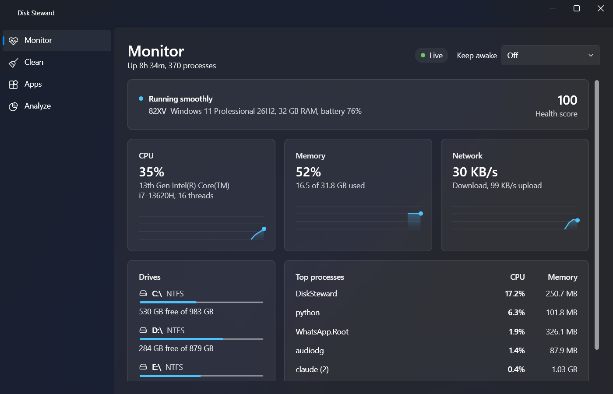
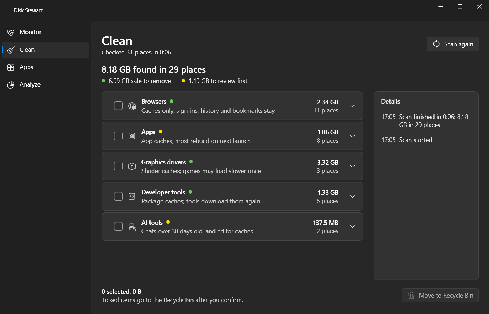
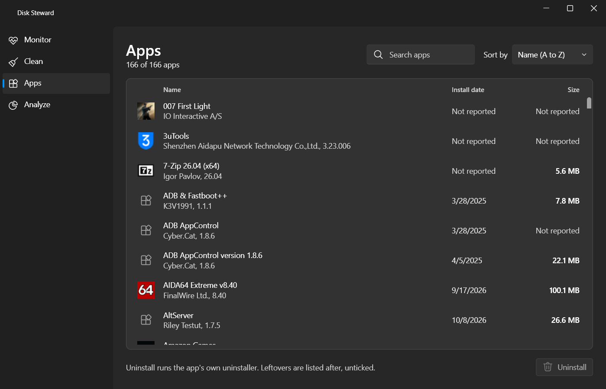
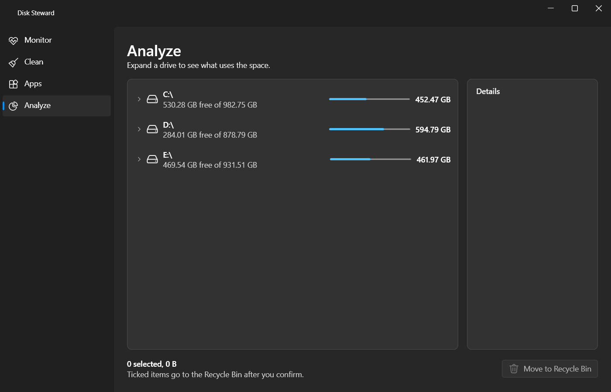

# Disk Steward

A native Windows app that frees disk space and shows what the machine is doing:
cache cleanup, app uninstall with leftover cleanup, a disk usage tree and a
live system monitor. Built with WPF and WPF-UI (Fluent) on .NET 10, in English
and Arabic. Runs as the normal user, no elevation.

## Contents

- [Requirements](#requirements)
- [Build and run](#build-and-run)
- [Features](#features)
- [Safety](#safety)
- [License](#license)
- [Docs](#docs)

## Requirements

- Windows 10 22H2 or Windows 11, x64.
- The .NET 10 SDK version pinned in `global.json`.

## Build and run

| Script | Purpose |
|---|---|
| `run.bat` | Run the app in Debug |
| `build.bat` | Publish `DiskSteward.exe` to `artifacts\publish\win-x64` |
| `test.bat` | Run all tests (the pre-commit hook runs them too) |
| `package.bat` | Test, build and create the MSI in `artifacts\installer` |

Pass `--no-pause` to skip the final key press.

## Features

- **Monitor** (start page): a health line, CPU, memory and network with
  one-minute charts, drive capacity and the top processes grouped by name,
  sampled every 2 seconds while the page is open. Keep awake holds off sleep
  for a set time or until turned off.
- **Clean:** scans on open. 76 cache locations in six groups: system, browsers,
  apps, graphics drivers, developer tools and AI tools (old Claude Code chats,
  Codex sessions, Cursor caches; Claude Code memory is never offered). Each
  item is marked safe to remove or worth a review first.
- **Apps:** installed apps with icons, sorted by name, size or install date,
  with search. Uninstall runs the app's own uninstaller, waits until Windows no
  longer lists it, then offers its leftover folders, unticked. Store apps are
  not listed.
- **Analyze:** a tree of drives and folders with used space against capacity.
  Folders list at once and measure in the background. Locked rows show why
  they cannot be removed.

| Clean | Apps | Analyze |
|---|---|---|
|  |  |  |

## Safety

Nothing is removed without ticking it and confirming, and removal only ever
moves items to the Recycle Bin. Every removal goes through `SafeRemover`,
which resolves junctions and links to the real path, re-checks
`ProtectedPaths` (Windows, Program Files, ProgramData, drive roots, the
profile and its known folders, system files such as the page file) and refuses
drives without a Recycle Bin rather than deleting.

## License

[MIT](LICENSE).

## Docs

- [docs/architecture.md](docs/architecture.md) - projects and dependencies.
- [docs/localization.md](docs/localization.md) - Arabic and English strings.
- [docs/release.md](docs/release.md) - release checklist.
- [docs/database.md](docs/database.md), [docs/known-issues.md](docs/known-issues.md),
  [docs/decisions/](docs/decisions/).
